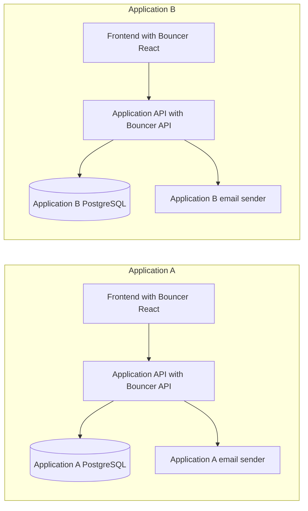
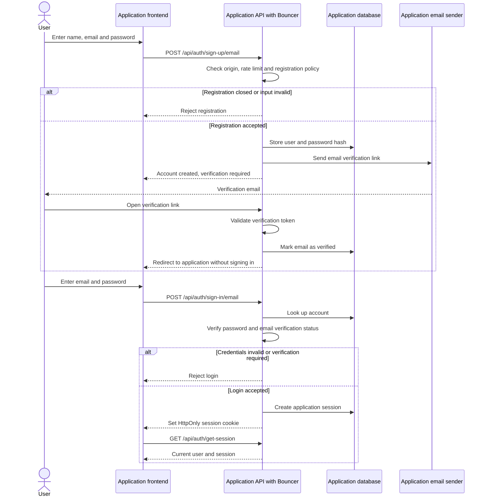
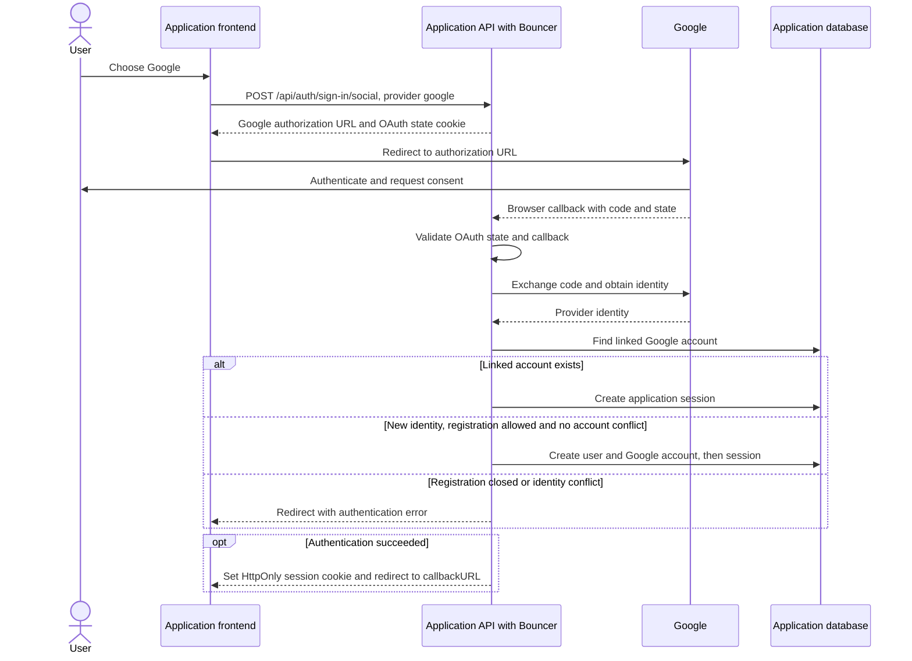
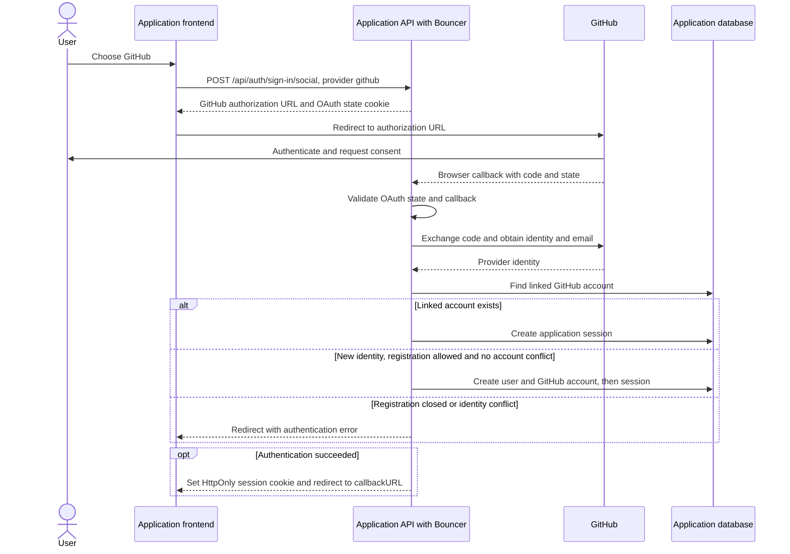
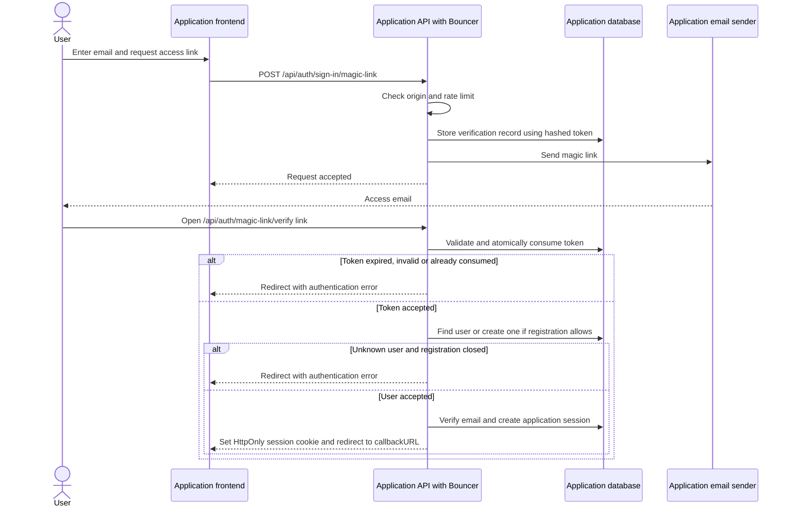
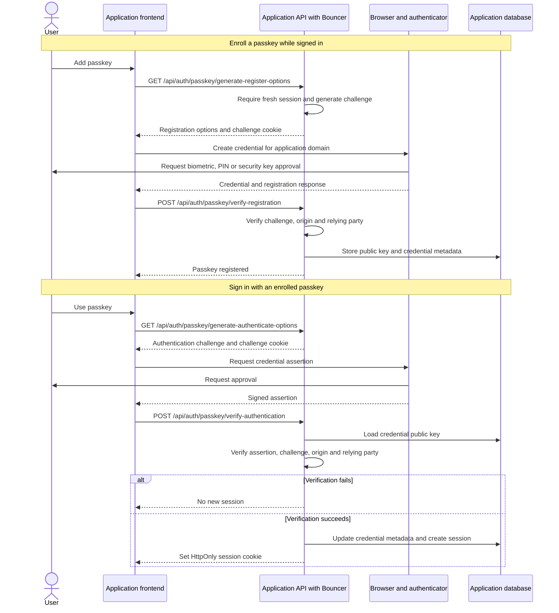
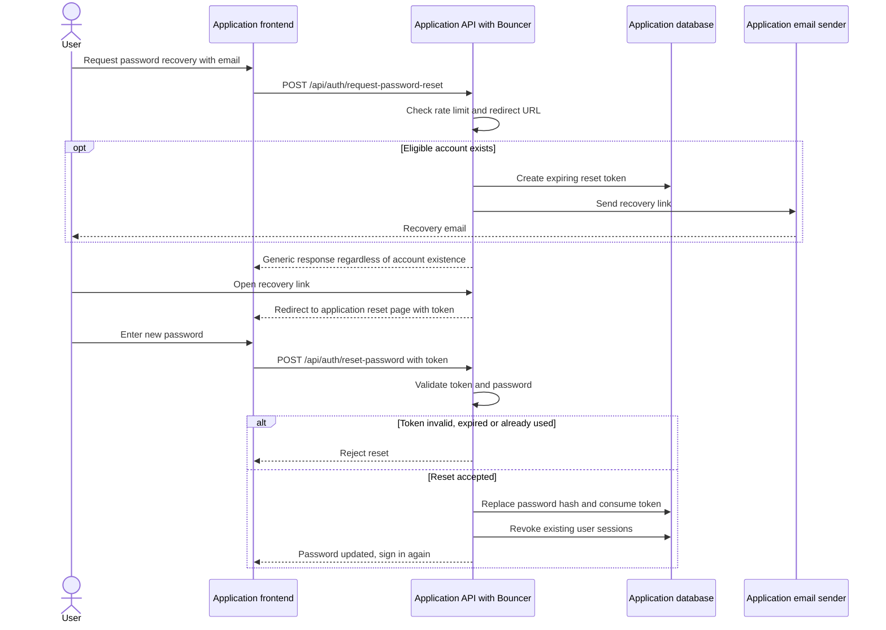
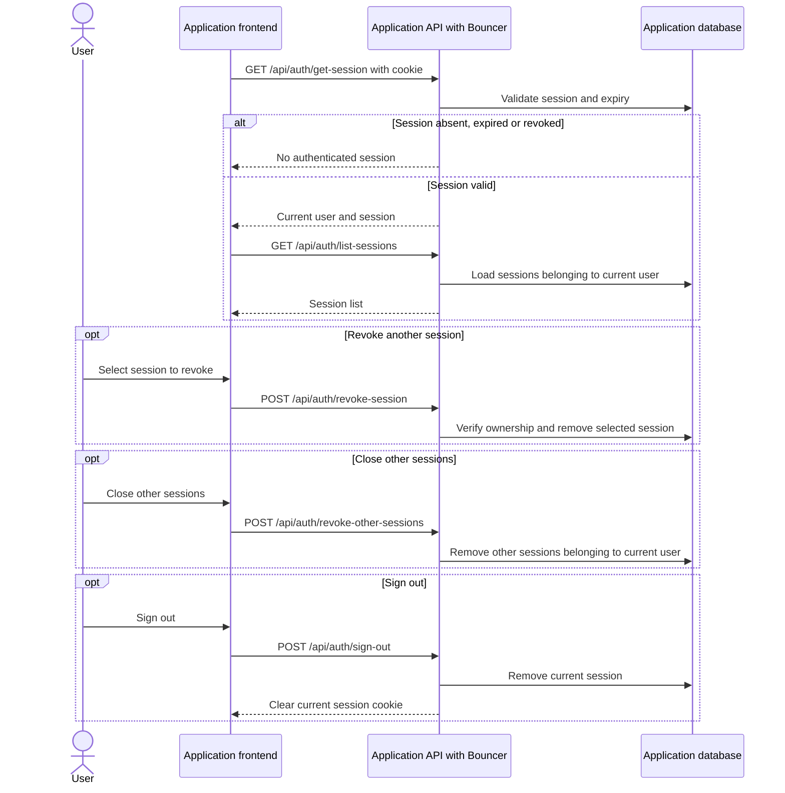

# Bouncer authentication flows

Each application imports `@bouncer/react` into its frontend and `@bouncer/api` into its own API. Users, sessions, database connections, secrets, email delivery and OAuth credentials belong to that application. Bouncer is a library, not a shared authentication service.

Endpoints below use the default `/api/auth` path. The application mounts the handler, runs migrations and protects its own API routes by checking the session. React components and `AuthGuard` control the interface; authorization must also run on the server.

## Application boundary

There is no shared user directory or cross-application session. SQLite is available for development; PostgreSQL is required by Bouncer in production.

## Email and password

Email verification is required by default. Registration does not create an authenticated session under this default. Passwords must contain 12 to 128 characters and are hashed on the server.

Setting `requireEmailVerification: false` changes this flow: verification is no longer a login requirement, and successful password registration can establish a session. A configured `sendMail` callback enables verification and recovery emails. With the default verification requirement, this callback is mandatory.

## Google

The application supplies its own Google client ID and secret. Register the application's `/api/auth/callback/google` URL with Google. The frontend only shows Google when it appears in the API capabilities.

Automatic account linking is disabled. An existing email/password account is not silently merged with a Google identity that uses the same email. Denied consent, invalid state or a failed token exchange returns an authentication error without a new session.

## GitHub

The application supplies its own GitHub client ID and secret. Register the application's `/api/auth/callback/github` URL with GitHub. The frontend only shows GitHub when it appears in the API capabilities.

The same account-linking policy applies to GitHub. Provider credentials stay in the application API; they are never passed to React. Real Google and GitHub sign-in requires credentials and provider setup; neither provider is configured in the default playground.

## Magic link

Magic links are enabled when `sendMail` is configured. A link is short-lived, single-use and stored in hashed form. Registration policy is enforced when an unknown user redeems a link.

For an existing account with an unverified email, successful magic-link verification removes its existing password and revokes its previous sessions before establishing the new session. The email owner can set a password through password recovery.

## Passkeys

Passkey enrollment requires an authenticated, fresh session. A user first creates or accesses their account through another method, then selects **Add passkey** in the account panel. The browser must support WebAuthn. Use HTTPS with a domain in production or `localhost` in development; numeric IP addresses are not supported as relying-party domains.

The private key remains with the authenticator. Removing a passkey from the account panel removes its server-side credential; it does not automatically revoke existing sessions. If the browser cancels the WebAuthn prompt, the client stops before submitting a verification response.

## Password recovery

The application must serve the recovery page at the redirect URL. The current `AuthPanel` builds a `reset-password` URL relative to `callbackURL`; the playground handles `/reset-password` and passes its token to `AuthPanel` through `resetToken`.

## Session checks and revocation

Sessions expire after seven days and can be renewed after one day of activity. Cookies are HttpOnly, use SameSite=Lax and are scoped to `/` by default (configurable through `cookiePath`); HTTPS adds the Secure attribute. Each application uses its own cookie prefix and secret.

For protected application endpoints, the host API passes incoming headers to `bouncer.getSession(headers)` and checks the result before accessing user data. The default cookie scope includes all application routes. When setting a narrower `cookiePath`, include both the auth endpoints and every application endpoint that needs the session cookie.
