# Flows de autenticación de Bouncer

Cada aplicación integra `@bouncer/react` en su frontend y `@bouncer/api` en su API. Conserva su propia base de datos, usuarios, sesiones, secreto, credenciales OAuth y envío de correo. No existe un servicio central de identidad ni SSO entre aplicaciones.

Las rutas usan `basePath: "/api/auth"`. Los ejemplos del cliente y la integración completa están en [Uso de la librería](uso-libreria.md). La sesión se comprueba también en cada endpoint privado; `AuthGuard` solo controla la interfaz.

## Frontera de cada aplicación

Cada aplicación necesita su propio `appId` estable y secreto aleatorio. Los prefijos separan tablas y nombres de cookies, pero no aíslan el sistema operativo ni aplicaciones maliciosas en el mismo hostname. PostgreSQL es obligatorio con `NODE_ENV=production`; SQLite queda para desarrollo.

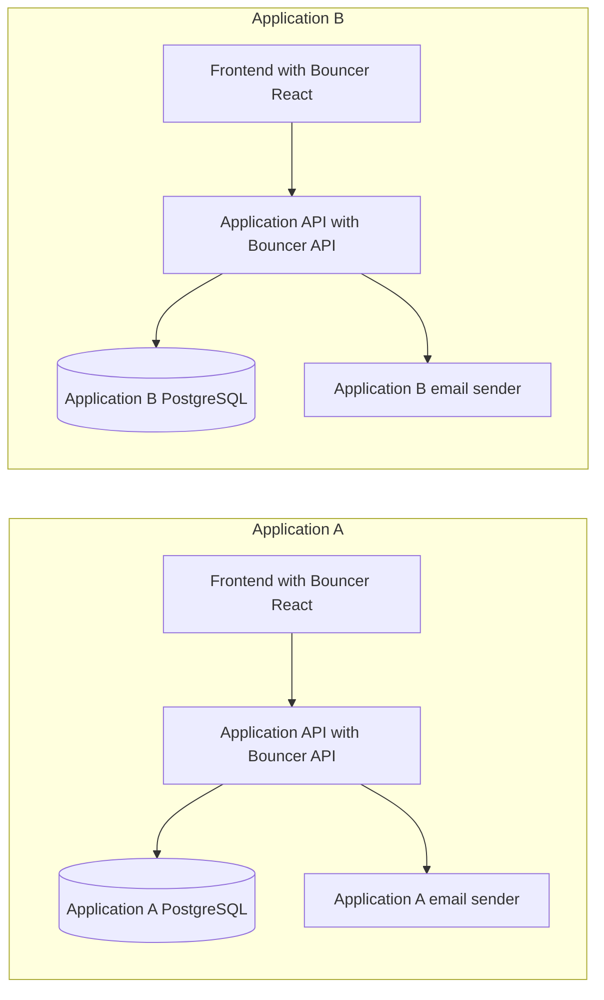

## Descubrimiento y autorización

Antes de renderizar el proveedor, consultar `GET /api/auth/bouncer-config`. Con `methods`, las claves omitidas quedan deshabilitadas también en la API. Sin ese objeto: contraseña por correo habilitada, magic link según disponibilidad de correo, proveedores según credenciales y passkeys por defecto sobre dominio/localhost. Usuario y contraseña requieren activación explícita.

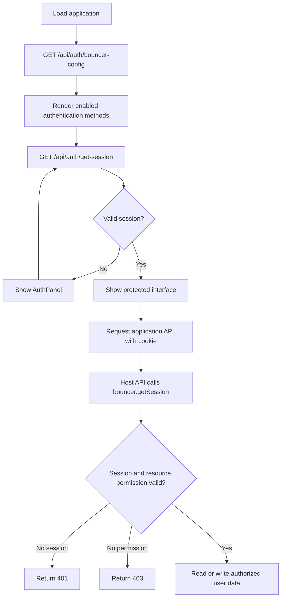

`AuthGuard` no asigna permisos. La API anfitriona devuelve 401 sin sesión y 403 si el usuario carece de permiso sobre el recurso. Ante fallos de configuración, red o base de datos, debe impedir el acceso y mostrar un error recuperable.

## Correo y contraseña

Activar `methods.emailPassword`. Alta con nombre, correo y contraseña de 12–128 caracteres por defecto; `minPasswordLength` permite aumentar el mínimo hasta 128. Con la política predeterminada se envía verificación, no se inicia sesión al registrarse y el acceso se rechaza hasta verificar el correo.

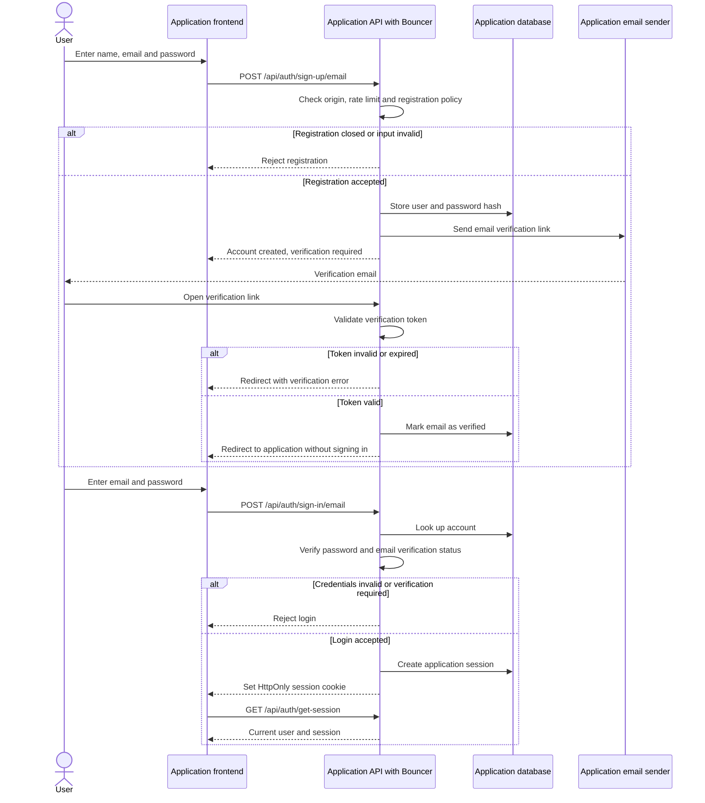

`requireEmailVerification: false` permite entrar sin verificar y puede establecer sesión tras el alta. Verificar un enlace no inicia sesión automáticamente. Se requiere `sendMail` con la política predeterminada; sus fallos se propagan. Para reenviar la verificación se usa `client.sendVerificationEmail({ email, callbackURL })`.

## Usuario y contraseña

Activar `methods.usernamePassword`. El alta sigue siendo `/sign-up/email`, incluyendo `username`, nombre, correo y contraseña. El correo sigue siendo necesario para verificación y recuperación. El usuario se normaliza a minúsculas, admite 3–40 caracteres ASCII (letras, números, punto, guion y guion bajo) y es inmutable.

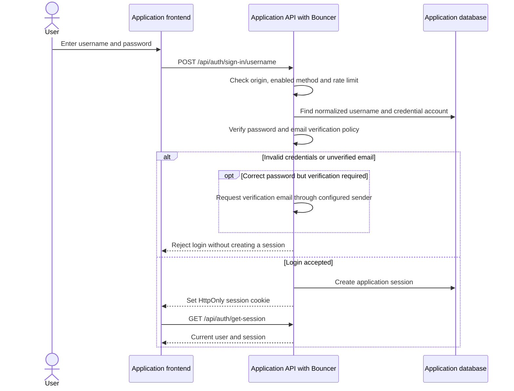

El acceso usa `client.signIn.username({ username, password })`. Si ambos métodos están activos, el panel interpreta un identificador con `@` como correo; los demás como usuario. Una cuenta sin nombre de usuario puede añadirlo desde `AccountPanel` con `client.updateUser({ username })`. No hay cambio posterior; `/is-username-available` está deshabilitado para reducir enumeración.

## Google

Configurar credenciales propias en `socialProviders.google` y activar `methods.google` si existe `methods`. Registrar exactamente `https://<dominio>/api/auth/callback/google` en Google (ajustar basePath). El cliente llama `signIn.social({ provider: "google", callbackURL })`.

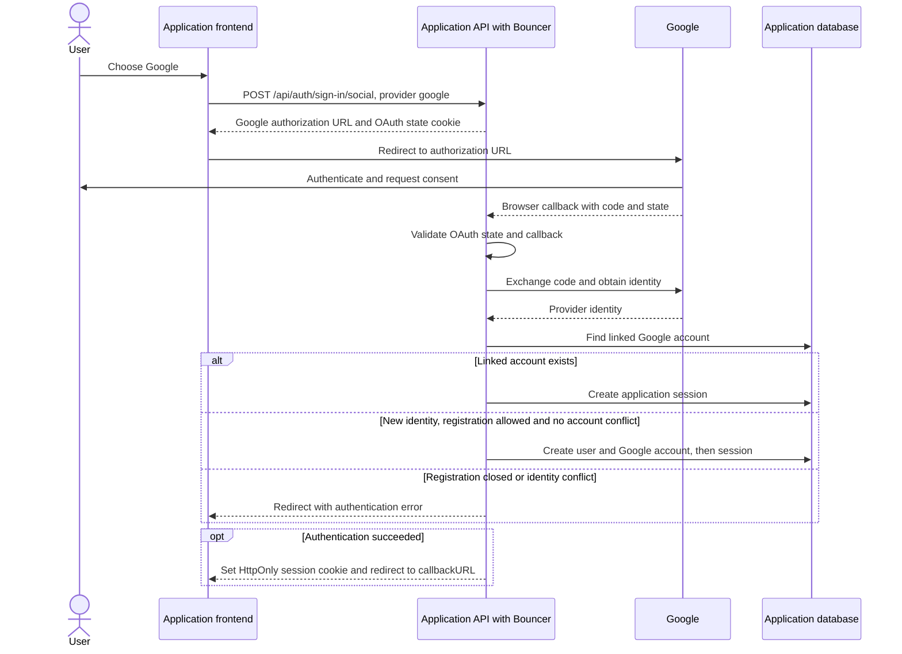

El proveedor valida estado y callback antes de crear sesión. La vinculación automática de cuentas está desactivada: compartir correo con una cuenta existente no implica fusionarlas. Credenciales incorrectas, denegación del consentimiento o conflicto de cuenta terminan en error. `registration: false` impide altas nuevas por este método. El consentimiento real de Google requiere validación manual con credenciales propias.

## GitHub

Configurar `socialProviders.github` y `methods.github` si se usa selección explícita. Registrar `https://<dominio>/api/auth/callback/github`. El cliente llama `signIn.social({ provider: "github", callbackURL })`.

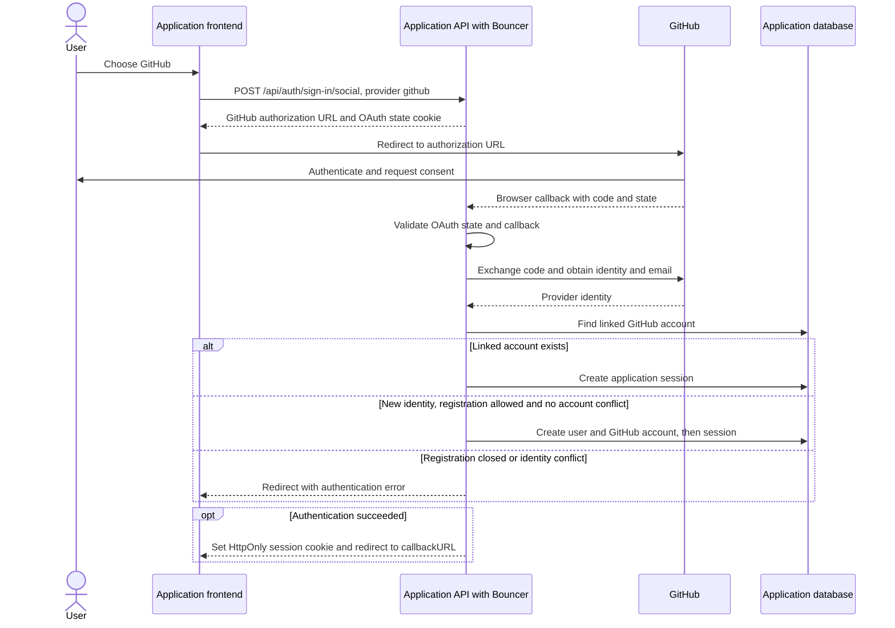

Aplica la misma política de vinculación y registro que en Google. Los secretos permanecen en la API; React solo recibe las capacidades. Verificar manualmente el retorno del proveedor y el caso de correo no disponible/privado con la configuración real; los tests locales no sustituyen esa prueba.

## Enlace mágico

Activar `methods.magicLink` y `sendMail`; sin `methods`, basta tener envío de correo. Solicitar con `client.signIn.magicLink({ email, callbackURL })`; el usuario abre el enlace recibido y vuelve a la aplicación con sesión. Caduca por defecto a los 300 segundos, configurable entre 60 y 900; se almacena hasheado y solo se consume una vez.

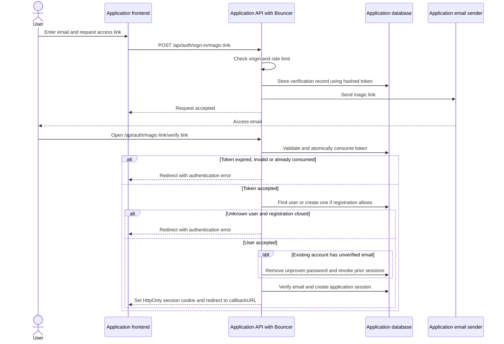

`registration: false` impide crear una cuenta desconocida al canjear el enlace. En una cuenta existente con correo sin verificar, el canje elimina la contraseña no demostrada y revoca sesiones anteriores antes de abrir la nueva sesión. El dueño puede fijar una contraseña mediante recuperación. Un token consumido no sirve aunque falle después la creación de cuenta; solicitar otro enlace.

## Passkeys: alta, acceso, listado y borrado

Activar `methods.passkeys`. Requiere WebAuthn y dominio HTTPS, o localhost en desarrollo; Bouncer rechaza IP numérica como relying party. Primero hay que entrar por otro método para registrar la credencial desde una sesión reciente. Configurar solo passkeys deja sin alta inicial a usuarios nuevos.

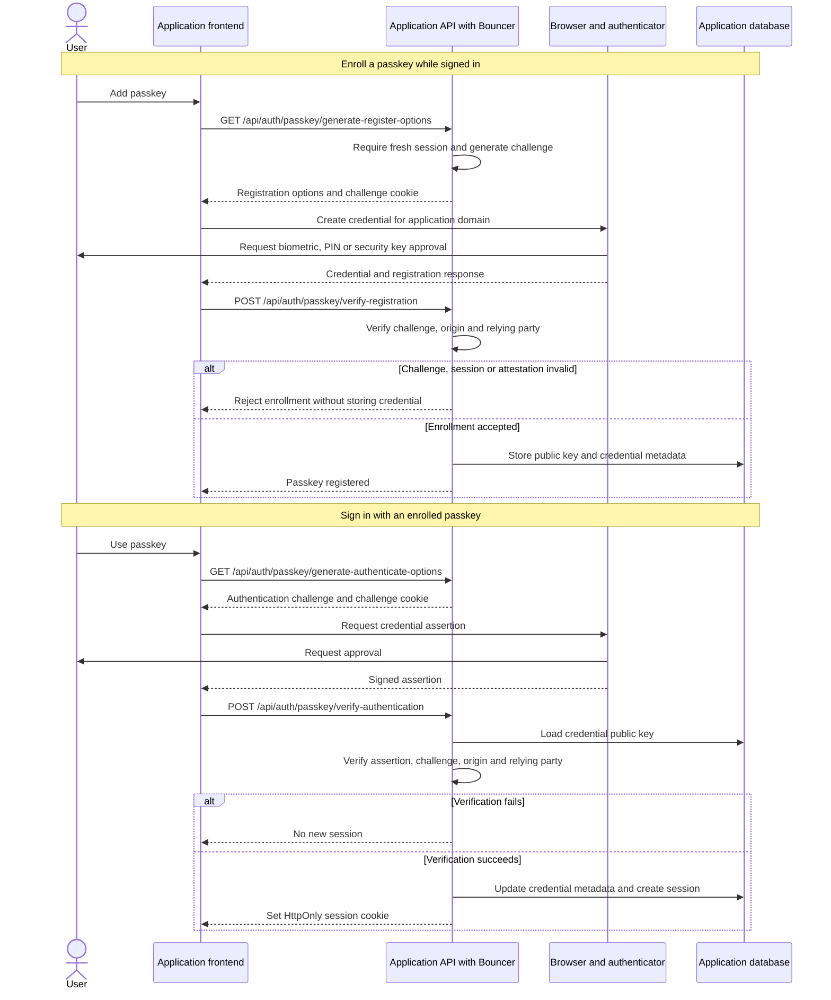

`client.passkey.addPasskey({ name: "Mi dispositivo" })` inicia el registro; `client.signIn.passkey()` autentica sin contraseña. `client.useListPasskeys()` lista credenciales del usuario y `client.passkey.deletePasskey({ id })` las elimina. La clave privada permanece en el autenticador; borrar una passkey no revoca sesiones ya abiertas. Cancelar el diálogo no abre sesión. Mantener un método de recuperación y planificar el dominio definitivo: cambiar el RP ID puede dejar las credenciales anteriores inutilizables.

## Recuperación de contraseña

Disponible cuando hay autenticación por contraseña y envío de correo (`capabilities.passwordReset`). `client.requestPasswordReset({ email, redirectTo })` devuelve respuesta genérica exista o no la cuenta. El anfitrión debe servir la página de recuperación y pasar el parámetro `token` a `<AuthPanel resetToken={token} />`.

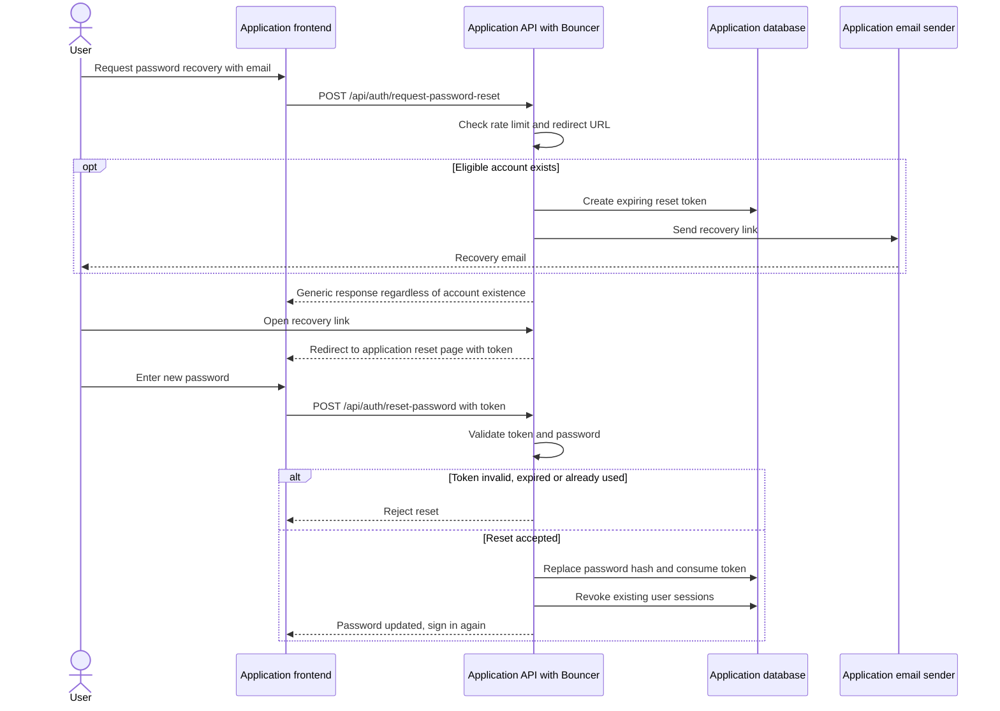

`AuthPanel` calcula `reset-password` relativo a `callbackURL`; la barra final importa si se usa subruta. El enlace pasa por la API y redirige a esa página con token. `client.resetPassword({ newPassword, token })` consume el token, actualiza la contraseña y revoca sesiones. Token inválido, caducado o ya usado falla; volver a solicitarlo. No se inicia sesión automáticamente.

## Cambio de contraseña autenticado

El cliente expone `client.changePassword({ currentPassword, newPassword, revokeOtherSessions: true })` cuando contraseña y correo permiten los endpoints de gestión de contraseña. `AccountPanel` no trae formulario de cambio; lo implementa el anfitrión.

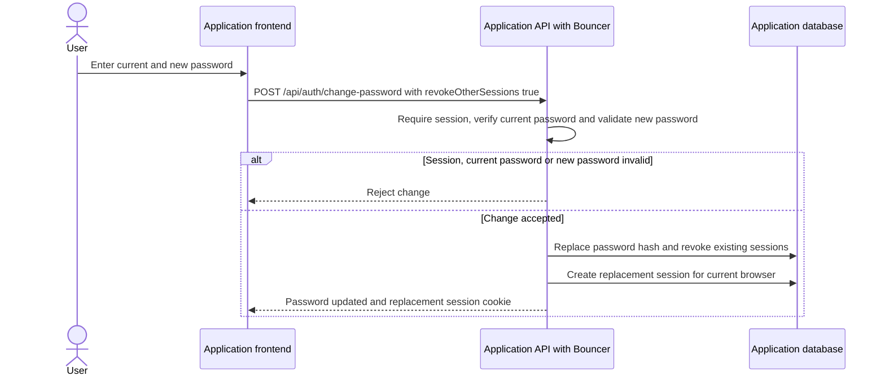

Requiere sesión y contraseña actual válida. El diagrama muestra explícitamente `revokeOtherSessions: true`: se revocan sesiones previas y se establece una sesión de reemplazo para el navegador actual. Recuperación es el camino cuando se desconoce la contraseña actual; no son operaciones intercambiables.

## Sesión, renovación y revocación

La sesión dura siete días y puede renovarse después de un día de actividad. Cookies HttpOnly, SameSite=Lax y Path=/ por defecto; Secure cuando `baseURL` usa HTTPS. `cookiePath` debe cubrir tanto autenticación como todos los endpoints que necesitan sesión.

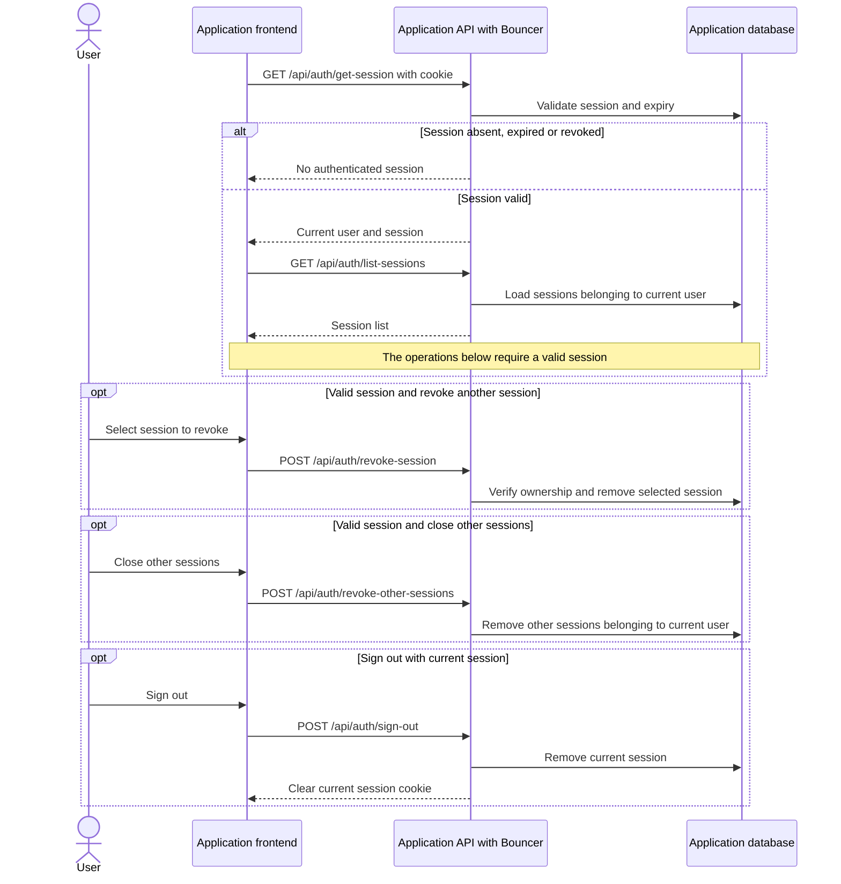

Consultar con `client.getSession()` o `useSession()`. `client.listSessions()` requiere sesión; `client.revokeSession({ token })` comprueba pertenencia, `client.revokeOtherSessions()` cierra las demás y `client.signOut()` cierra la actual. Los tokens de sesiones son credenciales: no registrarlos ni enviarlos a analítica. La API privada llama `bouncer.getSession(fromNodeHeaders(req.headers))` antes de acceder a datos.

## Fallos y responsabilidad del anfitrión

`sendMail` debe esperar el resultado del proveedor y propagar fallos; una respuesta de alta o recuperación no demuestra entrega final del correo. La aplicación debe gestionar reintentos, errores de base de datos/red y cierre ordenado. No registrar URLs de verificación, magic link o recuperación, ni dejar esos parámetros en logs del proxy, analítica o Referer.

Los diagramas expresan el comportamiento esperado y no sustituyen pruebas: `npm run docs:check` renderiza todos los bloques Mermaid; `npm test` comprueba HTTP y `npm run test:e2e` el navegador. OAuth real y entrega de correo real requieren validación de la aplicación consumidora.
